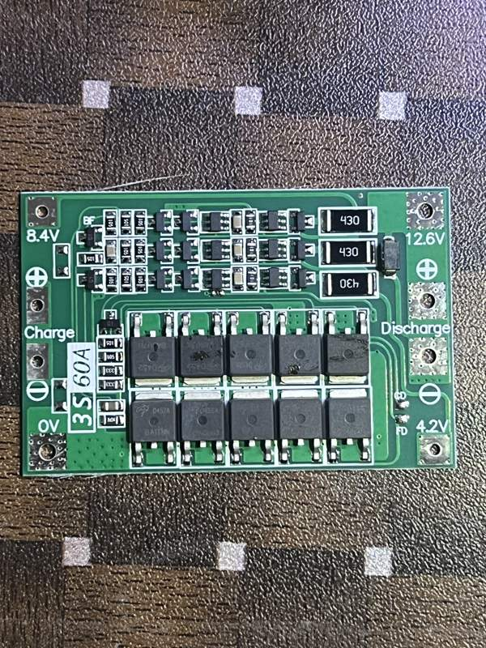
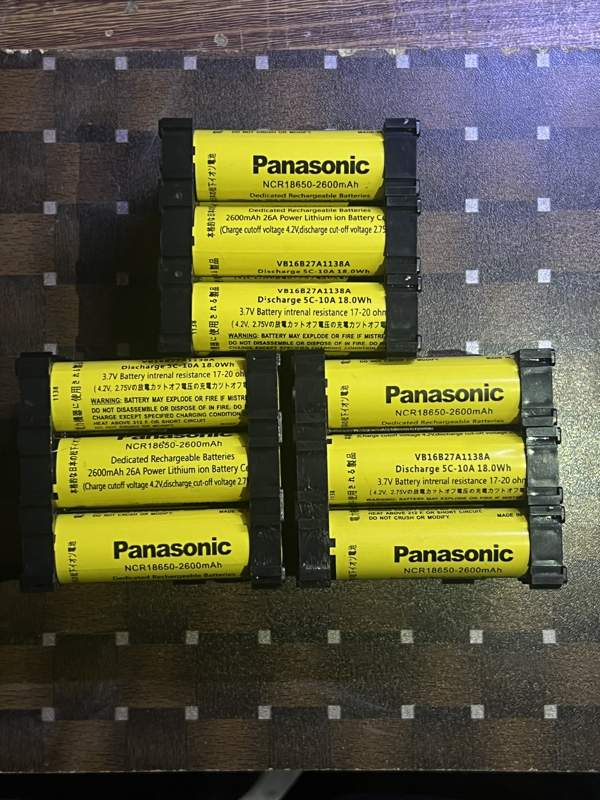
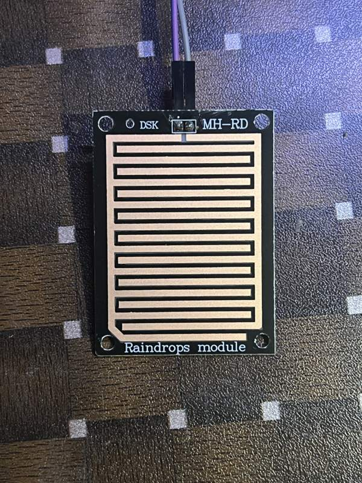
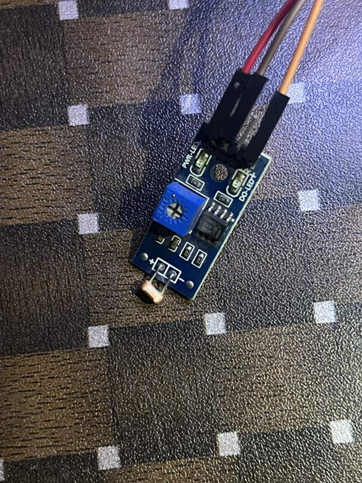
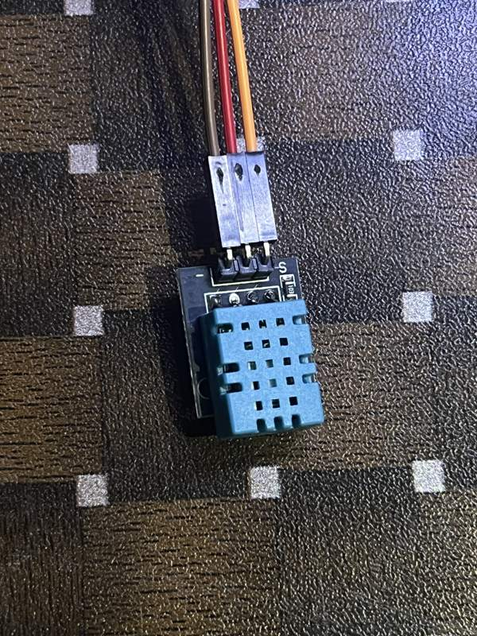
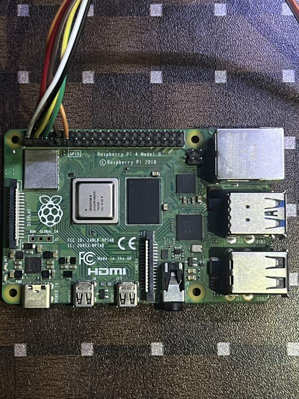
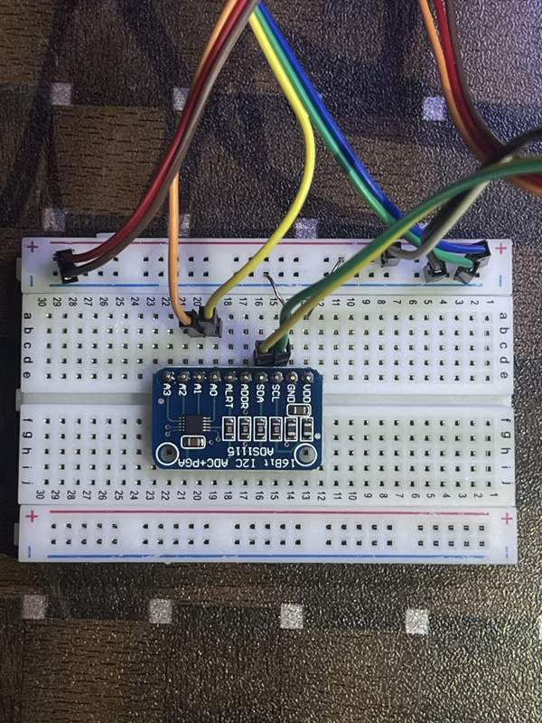
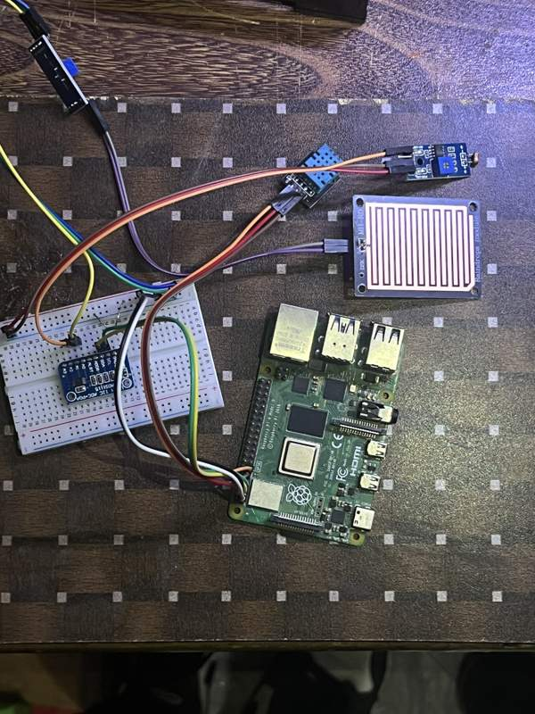
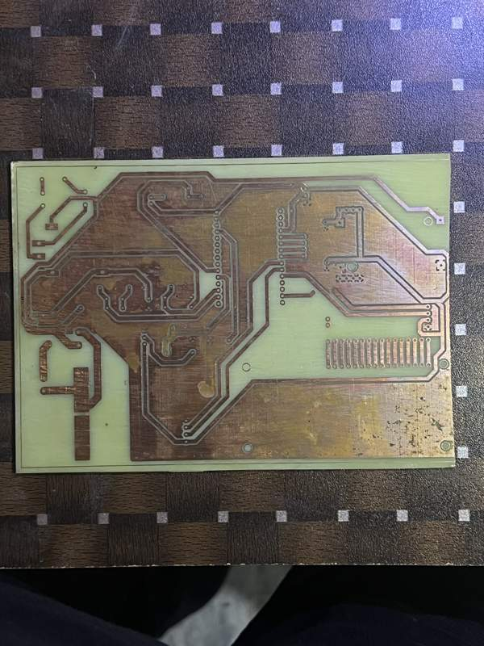

# Hardware photograph gallery

Web-viewable copies of the original HEIC files. Converted to JPEG on 26 October 2026; these are existing project photographs, not new test results. Original files remain in the archive.

## Photograph 1
Original: `FYP/Hardware imgs/IMG_2074.HEIC`

## Photograph 2
Original: `FYP/Hardware imgs/IMG_2075.HEIC`

## Photograph 3
Original: `FYP/Hardware imgs/IMG_2077.HEIC`

## Photograph 4
Original: `FYP/Hardware imgs/IMG_2078.HEIC`

## Photograph 5
Original: `FYP/Hardware imgs/IMG_2079.HEIC`

## Photograph 6
Original: `FYP/Hardware imgs/IMG_2080.HEIC`

## Photograph 7
Original: `FYP/Hardware imgs/IMG_2081.HEIC`

## Photograph 8
Original: `FYP/Hardware imgs/IMG_2083.HEIC`

## Photograph 9
Original: `FYP/Hardware imgs/SOC-PCB.HEIC`

